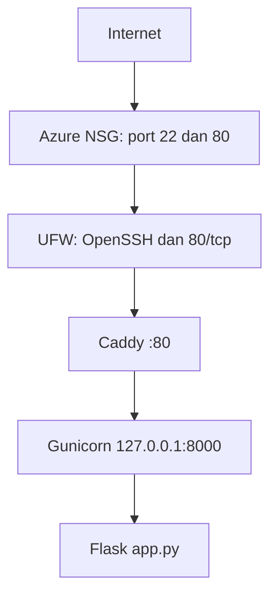
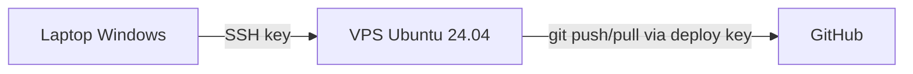

# Architecture v0.1 — KulkasKu

## Deployment View

## Client, Repository, VPS

## Resource Constraints
- 2 vCPU, 1 GiB RAM, disk 60 GB (Azure Standard B2ats v2)
- Swap 1 GB sebagai safety buffer
- Gunicorn dibatasi 1 worker + 2 thread karena RAM 1 GiB

## Security Decisions
- Administrasi memakai user non-root (cloudstudent)
- SSH key-only; password dan root login dinonaktifkan
- Firewall berlapis: Azure NSG dan UFW
- Backend hanya listen di loopback; Caddy satu-satunya pintu publik
- Deploy key GitHub khusus satu repository

## Current Limitations
- HTTP saja (belum HTTPS)
- Satu VPS, tanpa database, tanpa container
- Deployment manual

## Planned Evolution
- M04 DNS dan HTTPS
- M05 penyimpanan data bahan makanan
- M06 container
- M07 Infrastructure as Code
- M09 CI/CD
